# LeapQuant：基于精确循环状态量化的高效线性注意力

> **署名与许可说明（CC BY 4.0）**
>
> - 原文标题：*LeapQuant: Efficient Linear Attention with Accurate Recurrent State Quantization*
> - 原文作者：Yi Pan, Haocheng Xi, Kan Zhu, Xingyang Li, Yibo Wu, Mayank Mishra, Hongtao Zhang, William X. Zheng, Baris Kasikci, Song Han, Kurt Keutzer, Rishabh Iyer, Ion Stoica
> - 原文出处：arXiv:2609.38166（2026 年 9 月 29 日提交），<https://arxiv.org/abs/2609.38166>
> - 原文许可：[CC BY 4.0](http://creativecommons.org/licenses/by/4.0/)
> - 改动说明：本文是上述论文的**非官方中文翻译**（属于改编作品），依据作者上传的 LaTeX 源码逐段译出，原作者未审阅、也未为本译文背书。图片直接取自原文源码，未作修改，图内文字保持英文，必要处加了译注。
> - 记号约定：专有名词（GDN、KDA、FP32、INT8、vLLM、TileLang 等）保留英文；"Compensator Token"译为"补偿 token"；"per-step / per-token quantization"译为"逐步量化 / 逐 token 量化"（两者指同一种基线），"per-window quantization"译为"逐窗口量化"。形如【译注：……】的内容为译者补充，不属于原文。
> - 原文 PDF：同目录下 `2609.38166_LeapQuant.pdf`。

Yi Pan1*　Haocheng Xi1*　Kan Zhu2　Xingyang Li3　Yibo Wu4

Mayank Mishra1　Hongtao Zhang2　William X. Zheng1　Baris Kasikci2

Song Han3,5　Kurt Keutzer1　Rishabh Iyer1　Ion Stoica1

1UC Berkeley　2University of Washington　3MIT　4Perplexity AI　5NVIDIA

*同等贡献

---

## 摘要

近期的大语言模型（LLM）越来越多地采用混合架构，用线性注意力替代标准注意力，例如 Gated DeltaNet（GDN）和 Kimi Delta Attention（KDA）。这类模型把上下文压缩进一个固定大小的循环状态（recurrent state），大幅降低了长上下文处理的开销，但反复读取和更新这个状态仍然是推理中的主要瓶颈。量化是降低这一开销的自然手段，但由于舍入误差的累积以及状态中存在离群的行和列，量化可能显著损害模型质量。为应对这些挑战，我们提出 ***LeapQuant***——一种无需训练的方法，在 8 比特循环状态量化下实现近乎无损的性能。首先，为缓解误差累积，我们提出逐窗口量化（per-window quantization）：它*跃过*（leap over）一个 token 窗口，只在窗口末尾对状态做一次量化。在窗口内部，输出由固定的低比特状态与以高精度缓冲的更新共同计算得出。其次，为减小每次量化引入的误差，LeapQuant 把状态中最大的离群值保留为少量高精度的*补偿 token*（Compensator Tokens），它们与真实 token 共享同一条更新路径。随后，我们在量化前对剩余的残差进行平滑，以进一步降低误差。在 Qwen、Kimi 和 GLM 模型系列上的全面实验表明，***LeapQuant*** 大幅降低了推理过程中的显存与计算开销。在精度与 FP32 基线相当的前提下，它在 NVIDIA B200、RTX PRO 6000 和 RTX 5090 GPU 上实现了 kernel 级平均 2.05–3.70× 的加速，以及端到端推理平均 1.47× 的加速。

---

## 1 引言

线性注意力把 token 历史压缩进一个固定大小的循环状态，如今已被广泛用于长上下文大语言模型。例如，Qwen、Kimi 和 GLM 系列近期的混合架构用 Gated DeltaNet（GDN）、Kimi Delta Attention（KDA）等循环式线性注意力层替换了许多标准注意力层（Qwen Team, 2025; Yang et al., 2025; Team et al., 2025）。通过压缩 token 历史，这些层抑制了长上下文带来的计算量和显存增长，使推理更加高效。

然而，线性注意力中的循环状态在推理时仍会带来可观的显存带宽与显存容量开销。每生成一个 token，线性注意力层都要从 HBM 加载其状态矩阵，施加一次轻量级更新，计算该 token 的输出，再把更新后的矩阵写回 HBM。这种对整个状态的搬运在每个解码步都会重复一次。由于更新与读出（readout）所做的算术运算相对于搬运的字节数而言非常少，推理吞吐受限于 HBM 带宽（Williams et al., 2009）。因此，在大量线性注意力层和并发请求之间读写循环状态，占据了解码时间中相当大的一部分，如图 1(a) 所示。此外，在启用前缀缓存（prefix caching）时，服务系统要为每个已缓存的前缀单独保留一份状态，因此循环状态还会占用大量 GPU 显存（图 1(b)）（Pan et al., 2025）。

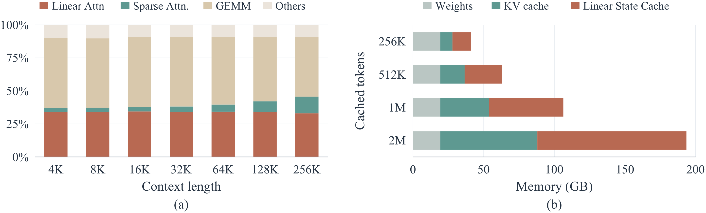

**图 1**：循环状态访问是 LLM 服务的主要开销之一。(a) GLM-5.3-Flash-NVFP4 在 B200 GPU、批大小 256 下的解码时间分解。随着上下文长度增长，花在线性注意力上的比例大致保持不变。(b) 启用前缀缓存时 Qwen3.5-9B 的 GPU 显存占用，假设每 1,024 个已缓存 token 保存一份线性注意力状态。

【译注：图例 Linear Attn = 线性注意力，Sparse Attn. = 稀疏注意力，GEMM = 矩阵乘，Others = 其他；Weights = 权重，KV cache = KV 缓存，Linear State Cache = 线性注意力状态缓存。横轴 Context length = 上下文长度，Memory = 显存；纵轴 Cached tokens = 已缓存 token 数。】

对循环状态做量化，是同时降低显存流量和显存占用的自然方法，但要在保持模型精度的前提下做到这一点并不容易。尤其是一种朴素做法——用标准低比特格式存储状态、并在每个 token 之后重新量化——会显著降低精度，在长思考过程（long thinking traces）中尤为严重。我们发现精度下降源于两类误差。第一，量化误差会递归累积：每次更新都从一个已经量化过的状态出发，而对结果再次量化又会引入新的舍入误差，导致状态在长生成过程中逐渐偏离 FP32 轨迹（图 3）。第二，大的离群值往往集中在状态的少数几行和几列中。这些离群值拉宽了量化范围，迫使较小的数值落在粗糙的量化级别上，放大了每次量化所引入的误差。因此，要实现精确的低比特量化，既要减少误差被引入的*频率*，也要减少每次量化所引入的误差*大小*。

我们提出 ***LeapQuant***，一种无需训练、可实现近乎无损模型质量的循环状态量化方法。LeapQuant 引入了两个关键思想，分别直接针对上述两类误差来源。第一，*逐窗口量化*让 LeapQuant 在再次量化状态之前先*跃过*一个 token 窗口，从而限制误差累积（图 2）。在每个窗口开始时，LeapQuant 以低精度存储循环状态。在窗口内，它保持这个状态不变，以更高精度缓冲各 token 的更新，并由固定的状态与缓冲的更新计算出每个输出。只有在窗口结束时，它才重建完整的更新后状态并对其量化，供下一个窗口使用。这样一来，LeapQuant 引入量化误差的频率更低，误差在长上下文中的累积也随之变慢。

为了解决由离群值造成的量化误差，LeapQuant 引入了*补偿 token*（Compensator Tokens），以高精度捕获状态中最大的离群值，从而降低每次量化的误差（图 4）。每个补偿 token 表示两个向量的高精度外积，能够同时捕获跨行和跨列的大幅值模式，留下一个更容易量化的残差。由于这些秩一项与真实 token 的更新形式完全相同，LeapQuant 只需少量额外向量就能把它们直接并入窗口的更新路径，而无需单独的循环状态更新。LeapQuant 还会在量化前沿通道方向对残差进行平滑，以进一步降低误差。LeapQuant 的这两项关键技术都无需训练，也不需要校准数据。

我们在 Qwen、Kimi 和 GLM 系列上的评估表明，***LeapQuant*** 大幅降低了显存开销并提升了推理吞吐。在 12 个"模型–任务"组合上，LeapQuant 达到了与 FP32 基线相当的精度，同时将状态显存流量降低 3.4×，并将端到端显存占用最多降低 56%。在 NVIDIA B200、RTX PRO 6000 和 RTX 5090 GPU 上，LeapQuant 实现了 kernel 级平均 2.05–3.70× 的加速，以及端到端推理平均 1.47× 的加速。

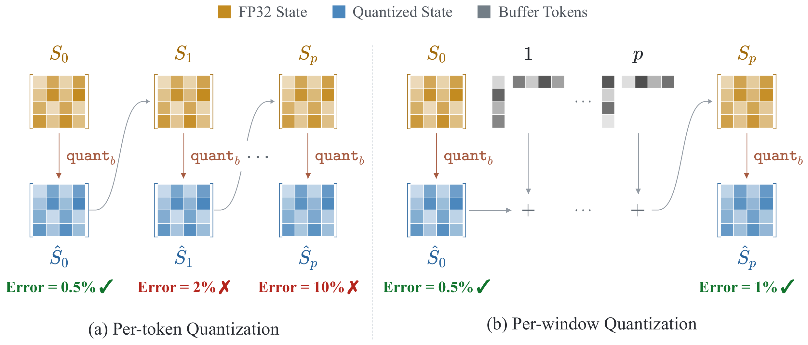

**图 2**：逐 token 量化与逐窗口量化的对比。逐 token 量化在每次更新后都对完整状态重新量化。逐窗口量化保持量化后的边界状态 $$\hat S_0$$ 不变，以更高精度缓冲窗口内的 $$p$$ 个更新，并由它们重建状态；完整状态每个窗口只量化一次，得到 $$\hat S_p$$。

【译注：图例 FP32 State = FP32 状态，Quantized State = 量化状态，Buffer Tokens = 缓冲的 token 更新；Error = 误差。(a) 逐 token 量化，(b) 逐窗口量化。】

---

## 2 相关工作

**线性注意力与混合模型。** Katharopoulos et al. (2020) 提出线性注意力，用基于固定大小状态的递推替代 softmax 注意力（Vaswani et al., 2017）；随后的一系列工作借助数据相关的门控和 delta 规则更新提升了其表达能力，包括 GLA（Yang et al., 2023）、Mamba2（Dao & Gu, 2024）、DeltaNet（Schlag et al., 2021; Yang et al., 2024）、Gated DeltaNet（Yang et al., 2025）以及 KDA（Team et al., 2025）。它们的分块（chunkwise）形式（Yang et al., 2023）在训练和预填充（prefill）阶段只在块边界处把状态物化到 HBM 中，并在 FLA（Yang & Zhang, 2024）等库中用高效的 Triton kernel（Tillet et al., 2019）实现。近期的 LLM 将少量全注意力或稀疏注意力层与占多数的线性注意力层组合在一起（Qwen Team, 2025; Team et al., 2026; Z.ai, 2026; Blakeman et al., 2025），这类混合模型已成为长上下文、长推理负载的常见设计。这些工作关注的是架构本身及其全精度 kernel，循环状态的存储精度并不在它们的考虑范围之内。

**机器学习模型的量化。** 量化已成为降低 LLM 推理显存需求的标准做法。GPTQ（Frantar et al., 2022）和 AWQ（Lin et al., 2024）等仅权重（weight-only）量化方法把权重压缩到 4 比特；SmoothQuant（Xiao et al., 2023）则通过把激活中的离群值迁移到权重中，进一步对激活进行量化。随着上下文变长，KV 缓存成为主要的显存开销。KIVI（Liu et al., 2024）对键按通道量化、对值按 token 量化；KVQuant（Hooper et al., 2024）把离群值隔离到一个稀疏的全精度分量中。SVDQuant（Li et al., 2024）和 GEAR（Kang et al., 2024）把离群值吸收进一个高精度的低秩分量，再对残差进行量化。对于状态空间模型（SSM），Quamba（Chiang et al., 2025b）和 MambaQuant（Yue et al., 2025）对权重和激活进行量化，Quamba2（Chiang et al., 2025a）和 Q-Mamba（Tianqi et al., 2025）则进一步量化了缓存的 SSM 状态。这些方法专门针对 Mamba 的选择性 SSM，而后者的状态更新方式与其他线性注意力架构不同。

**线性注意力服务中的状态管理。** 由于循环状态在每个 token 处都会被覆写，服务系统需要额外的机制来保留或恢复较早的状态。ReplaySSM（Liou & Dao, 2026）为支持投机解码（speculative decoding），在检查点处保存状态并重算最近的若干 token，从而高效地回滚状态。逐窗口量化同样从一个已存储的边界状态出发并重放最近的更新，但它利用这一结构来提升量化精度。Marconi（Pan et al., 2025）通过把已缓存前缀的状态保存为检查点，为混合模型实现了前缀缓存，代价是更大的显存占用。

---

## 3 方法

### 3.1 预备知识

我们考虑线性注意力模型中的一个头，其循环状态矩阵为 $$S_t\in\mathbb{R}^{d_k\times d_v}$$，查询为 $$q_t\in\mathbb{R}^{d_k}$$，值与输出为 $$v_t,o_t\in\mathbb{R}^{d_v}$$。我们研究这样一类递推：其更新由一个对角衰减和随后的单个秩一 delta 规则（Schlag et al., 2021）更新组成：

$$
S_t = \mathrm{Diag}(\alpha_t)S_{t-1} + k_t\bigl(v_t-S_{t-1}^{\top}\beta_t\bigr)^{\top},\qquad o_t=S_t^{\top}q_t. \tag{1}
$$

其中 $$\mathrm{Diag}(\alpha_t)$$ 为对角衰减（Team et al., 2025），$$k_t\in\mathbb{R}^{d_k}$$ 为键向量，$$\beta_t\in\mathbb{R}^{d_k}$$ 为读取向量（对于不使用 delta 规则的模型，$$\beta_t=0$$）。附录 A 说明了其他线性注意力模型如何纳入这一形式。

对于状态量化，记 $$\hat S=\mathtt{quant}_b(S)$$，其中 $$\mathtt{quant}_b$$ 是 $$b$$ 比特量化算子，$$S$$ 为原始状态，$$\hat S$$ 为其量化表示（包括缩放因子等元数据）。我们用 $$S_t^{\mathrm{FP32}}$$ 表示式 (1) 在不做状态量化时独立演化的轨迹，用 $$E_t=\mathtt{dequant}_b(\hat S_t)-S_t^{\mathrm{FP32}}$$ 表示由量化引起的偏差，其中 $$\mathtt{dequant}_b$$ 为相应的反量化算子。下文中凡是量化状态参与运算的地方，都默认隐含了反量化。

### 3.2 逐窗口量化

朴素的状态量化模型会在*每个*解码步之后对完整状态做一次量化和反量化。在第 $$t$$ 步，它先由上一步的量化状态 $$\hat S_{t-1}$$ 计算出全精度的更新后循环状态 $$S_t$$，再对这个新的循环状态进行量化：

$$
\begin{aligned}
S_t &= \mathrm{Diag}(\alpha_t)\,\hat S_{t-1} + k_t\bigl(v_t-\hat S_{t-1}^{\top}\beta_t\bigr)^{\top},\\
\hat S_t &= \mathtt{quant}_b\bigl(S_t\bigr).
\end{aligned}
\tag{2}
$$

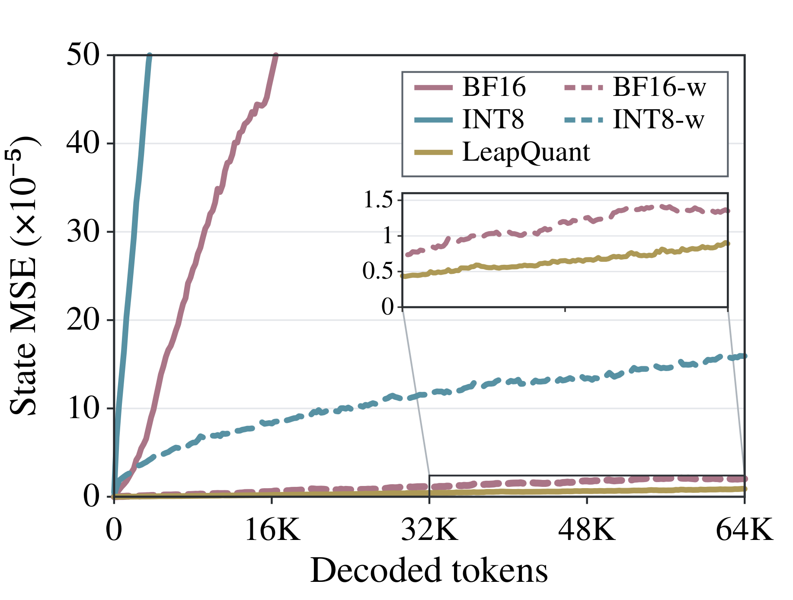

**图 3**：在 PG-19 上解码 64K 个 token 过程中的状态 MSE（Qwen3.5-9B）；带 -w 后缀的变体每个窗口量化一次。

【译注：纵轴 State MSE = 状态均方误差，横轴 Decoded tokens = 已解码 token 数。】

由于每次更新都从一个已量化的状态开始，它的舍入误差会被带入后续步骤，并可能在长上下文中不断累积（附录 B.1）。因此，逐步量化在每个 token 处都会引入一份新的误差。图 3 追踪了 Qwen3.5-9B 在解码 64K 个 token 的过程中，量化状态相对于 FP32 轨迹的误差。在逐步量化下，误差随上下文长度稳步增长，即使是 BF16 也不例外。随机舍入（stochastic rounding）帮助不大：它只把 BF16 在 64K 处的误差降低了 3×，还会让 INT8 发散。相比之下，按下文介绍的方式每 16 个 token 的窗口只量化一次（即 -w 变体），能把 64K 处的误差在 BF16 下降低 100×、在 INT8 下降低 39×。LeapQuant 进一步降低了每次窗口边界量化的误差，并在全程保持最低误差——甚至以一半的比特数做到了比逐窗口 BF16 还低。

受图 3 中误差增长现象的启发，我们提出**逐窗口量化**（图 2）。我们把每次更新写成"先衰减、再做一次秩一更新"的形式，其中修正向量 $$u_i$$ 由前一个状态计算得到。对于式 (1) 的每一个实例，这一更新都可以由衰减 $$\alpha_i$$、键向量 $$k_i$$ 和计算出的修正量 $$u_i$$ 来描述：

$$
u_i=v_i-S_{i-1}^{\top}\beta_i,\qquad S_i=\mathrm{Diag}(\alpha_i)S_{i-1}+k_i u_i^{\top}. \tag{3}
$$

现在考虑送入线性状态的 $$p$$ 个连续 token。为简便起见，把它们编号为 $$1,\ldots,p$$。我们保持量化后的边界状态 $$\hat S_0$$ 不变，并以更高精度缓冲这 $$p$$ 个三元组 $$(\alpha_i,k_i,u_i)$$。对于 $$a\le b$$，记从第 $$a$$ 步到第 $$b$$ 步的累积衰减为 $$\Gamma_{a:b}=\mathrm{Diag}(\alpha_b)\mathrm{Diag}(\alpha_{b-1})\cdots\mathrm{Diag}(\alpha_a)$$，并约定当 $$a>b$$ 时 $$\Gamma_{a:b}=I$$。那么对任意 $$1\le\ell\le p$$，从 $$\hat S_0$$ 开始展开式 (3) 可得（附录 B.2）：

$$
\begin{aligned}
S_\ell &= \Gamma_{1:\ell}\,\hat S_0 + \sum_{j=1}^{\ell}\Gamma_{j+1:\ell}\,k_j u_j^{\top}, \qquad 1\le\ell\le p,\\
\hat S_p &= \mathtt{quant}_b\bigl(S_p\bigr).
\end{aligned}
\tag{4}
$$

这正是线性注意力在训练和预填充中所用的块级（chunk-level）形式（Yang et al., 2024; 2025）：中间状态通过边界状态和缓冲的三元组来表示，因此在窗口内完整状态从不会被重新量化。只有在 $$\ell=p$$ 时，我们才物化 $$S_p$$，并把它量化为 $$\hat S_p$$ 供下一个窗口使用。这把量化频率降低为原来的 $$1/p$$，并大幅降低了长上下文下的状态误差。

### 3.3 补偿 Token（Compensator Tokens）

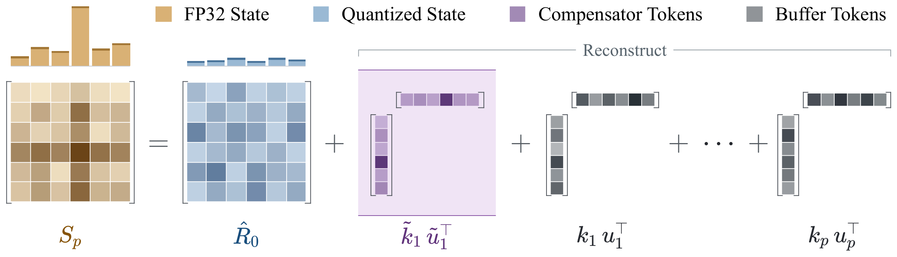

**图 4**：带补偿 token 的逐窗口状态重建。FP32 状态被拆分为三部分：一个低比特的量化残差、少量捕获其主要大幅值结构的高精度补偿 token，以及窗口内缓冲的真实 token 更新。补偿 token 吸收了主要的离群值，使残差各行的 $$\ell_2$$ 范数趋于平坦，从而更易量化。

【译注：图例 FP32 State = FP32 状态，Quantized State = 量化状态，Compensator Tokens = 补偿 token，Buffer Tokens = 缓冲的 token 更新；Reconstruct = 重建。】

尽管逐窗口量化降低了量化频率，重建出的状态 $$S_p$$ 仍可能含有集中在少数行和列中的大幅值离群值（图 6(a)），而且少数几个奇异分量承载了它的大部分能量（图 5）。这些离群值主导了量化缩放因子，迫使大多数元素用不必要的粗糙量化步长来表示。为解决这一问题，我们引入**补偿 token**（图 4），它在降低离群值所致量化误差的同时，能够自然地与逐窗口量化结合。

在量化 $$S_p$$ 之前，我们先拟合一个秩一矩阵 $$\tilde k\tilde u^{\top}$$，用来捕获其主要的大幅值结构。我们从 $$S_p$$ 中减去这个矩阵，只对残差 $$R_p$$ 进行量化。这样，最大的那些数值就被排除在待量化张量之外，缩小了它的动态范围，缓解了量化压力：

$$
\begin{aligned}
(\tilde k,\tilde u) &= \operatorname*{arg\,min}_{k,u} \bigl\lVert S_p-ku^{\top}\bigr\rVert_F,\\
R_p &= S_p-\tilde k\tilde u^{\top}, \qquad \hat R_p=\mathtt{quant}_b(R_p),\\
\tilde S_p &= \mathtt{dequant}_b\bigl(\hat R_p\bigr) +\tilde k\tilde u^{\top}.
\end{aligned}
\tag{5}
$$

其中 $$\lVert\cdot\rVert_F$$ 为 Frobenius 范数。我们把向量对 $$(\tilde k,\tilde u)$$ 称为一个**补偿 token**：它以更高精度保留了状态的主要分量，并且在配上恒等衰减后，与式 (3) 中真实 token 的秩一更新形式完全相同。与真实的输入 token 不同，它不是由模型产生的，也不产生输出。它只存在于窗口表示之中，被放在下一个窗口的真实 token 更新之前。由于解码 kernel 直接对秩一更新进行运算，它可以沿着与真实 token 相同的路径处理补偿 token，无需任何针对特定模型的修改。

在下一个窗口开始时，量化残差与补偿 token 共同表示初始状态。解码 kernel 先处理补偿 token，再处理真实 token 的更新，因此后续的更新和输出都使用合并后的状态，无需额外的 kernel。

在每个窗口结束时，我们由量化残差、当前的补偿 token 以及该窗口内真实 token 的更新重建出 $$S_p$$。然后丢弃旧的补偿 token，为 $$S_p$$ 拟合新的近似，并对剩余残差进行量化。新的量化残差和补偿 token 用来初始化下一个窗口。

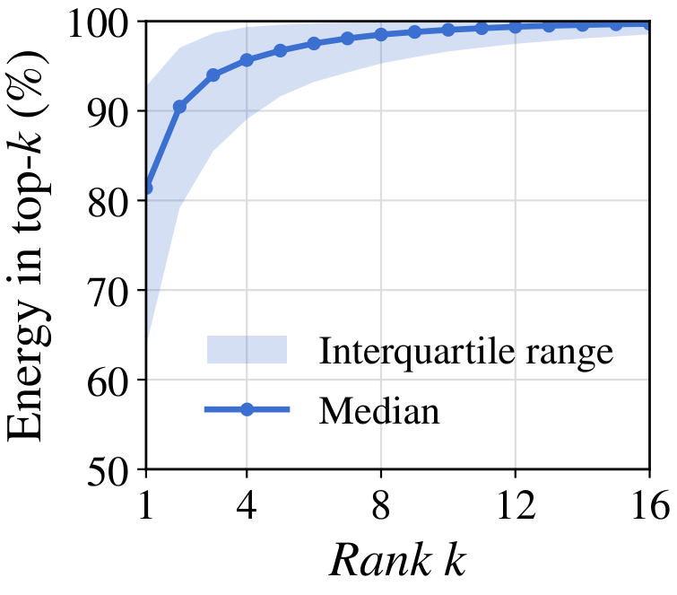

**图 5**：Qwen3.5-9B 模型中前若干个奇异值所占的能量。

【译注：纵轴 Energy in top-k = 前 k 个奇异值的能量占比；横轴 Rank k = 秩 k；Median = 中位数；Interquartile range = 四分位距。】

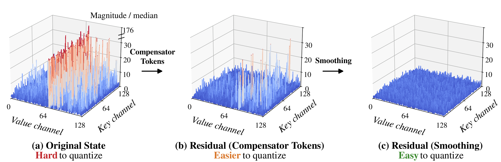

**图 6**：Qwen3.5-9B 某个头（第 13 层第 16 个头）在 8K 上下文处的幅值；(a) 和 (b) 以 $$S$$ 幅值的中位数归一化，(c) 以平滑后残差幅值的中位数归一化。离群值在 (a) 中最高可达中位数的 176 倍，经补偿 token 处理后 (b) 降至 47 倍，再经平滑后 (c) 降至 5.3 倍。

【译注：(a) Original State = 原始状态，难以量化；(b) Residual (Compensator Tokens) = 经补偿 token 处理后的残差，较易量化；(c) Residual (Smoothing) = 经平滑后的残差，易于量化。Value channel = 值通道，Key channel = 键通道，Magnitude / median = 幅值 / 中位数。】

这一构造可以直接推广到 $$r$$ 个补偿 token。令 $$\tilde K=[\tilde k_1,\ldots,\tilde k_r]\in\mathbb{R}^{d_k\times r}$$、$$\tilde U=[\tilde u_1,\ldots,\tilde u_r]\in\mathbb{R}^{d_v\times r}$$ 分别收集它们的向量对。它们的合并贡献为

$$
\begin{aligned}
\tilde K\tilde U^{\top} &= \sum_{h=1}^{r}\tilde k_h\tilde u_h^{\top},\\
R_p &= S_p-\tilde K\tilde U^{\top}, \qquad \hat R_p=\mathtt{quant}_b(R_p),\\
\tilde S_p &= \mathtt{dequant}_b\bigl(\hat R_p\bigr) +\tilde K\tilde U^{\top}.
\end{aligned}
\tag{6}
$$

通过这种方式，补偿 token 以更高精度保留了主要的状态结构，并留下一个更易量化的残差。对于实践中使用的较小的 $$r$$，重建补偿 token 的开销完全被状态的显存读取所掩盖。在每个窗口边界，我们在 Tensor Core 上重新拟合补偿 token，而无需把旧的补偿 token 物化到稠密状态中；因此当 $$r\le 8$$ 时，在所有设置下暴露出来的 kernel 级开销都不超过 7%。

### 3.4 残差平滑

补偿 token 以更高精度保留了主要的低秩结构，但剩余残差在各个键行（key row）之间的幅值仍可能不均匀（图 6(b)）。少数幅值较大的键通道和值通道可能主导量化缩放因子，让较小的元素只能获得粗糙的分辨率。因此，我们在量化前对残差进行平滑，平衡其各行的幅值，使它更容易用低精度表示（图 6(c)）。

令 $$R_0$$ 表示窗口开始时的残差。平滑向量 $$c\in\mathbb{R}_{>0}^{d_k}$$ 的每个元素取对应键行平均绝对值的平方根，并设置一个小的正下界以避免除零。令 $$C=\mathrm{Diag}(c)$$，我们在量化前左乘 $$C^{-1}$$，以平衡各键行的幅值。我们对缩放后的残差进行量化，并把平滑缩放因子与量化残差一起保存。由于分布会随时间变化，这些缩放因子在每个窗口内保持固定，但在每个边界处都根据新的残差重新计算。

反量化之后，再乘以 $$C$$ 即可恢复原始的键坐标。这个变换本身是可逆的，只有夹在中间的量化会引入近似。再加回保持不变的高精度补偿 token，即可恢复初始状态。把这一表示代入式 (4)，就得到窗口末尾重建出的状态 $$S_p$$（附录 B.3 推导了相应的读出形式），而缓冲的真实 token 更新无需任何改动：

$$
\begin{aligned}
\hat R_0^C &= \mathtt{quant}_b(C^{-1}R_0),\\
S_p &= \Gamma_{1:p} \bigl[C\,\mathtt{dequant}_b\bigl(\hat R_0^C\bigr) +\tilde K\tilde U^{\top}\bigr] +\sum_{j=1}^{p}\Gamma_{j+1:p}\,k_j u_j^{\top}.
\end{aligned}
\tag{7}
$$

---

**表 1**：下游任务性能（%，越高越好）。在 8 比特、6 比特和 4 比特各组内，每列最佳分数以粗体标出。

<table>
<thead>
<tr><th rowspan="2" align="left">方法</th>
<th colspan="4">Qwen3.5-9B</th>
<th colspan="4">Qwen3.5-35B-A3B</th>
<th colspan="4">Kimi-Linear-48B-A3B</th>
<th rowspan="2">平均</th>
</tr>
<tr><th>AIME</th><th>GPQA</th><th>LCB</th><th>MMLU</th><th>AIME</th><th>GPQA</th><th>LCB</th><th>MMLU</th><th>AIME</th><th>GPQA</th><th>LCB</th><th>MMLU</th></tr>
</thead>
<tbody>
<tr><td align="left">FP32</td><td align="right">87.9</td><td align="right">81.3</td><td align="right">64.1</td><td align="right">83.3</td><td align="right">91.5</td><td align="right">84.7</td><td align="right">75.6</td><td align="right">85.9</td><td align="right">67.5</td><td align="right">70.3</td><td align="right">41.4</td><td align="right">72.4</td><td align="right">75.5</td></tr>
<tr><td align="left">BF16</td><td align="right">72.1</td><td align="right">66.2</td><td align="right">49.6</td><td align="right">81.0</td><td align="right">85.8</td><td align="right">79.3</td><td align="right">67.2</td><td align="right">85.2</td><td align="right">64.3</td><td align="right">68.1</td><td align="right">41.0</td><td align="right">64.0</td><td align="right">68.7</td></tr>
<tr><td colspan="14" align="left"><i>8 比特方法</i></td></tr>
<tr style="background:#E4EEFB"><td align="left"><b>LeapQuant（本文）</b></td><td align="right"><b>87.9</b></td><td align="right"><b>81.8</b></td><td align="right"><b>64.1</b></td><td align="right"><b>83.8</b></td><td align="right"><b>91.0</b></td><td align="right"><b>83.9</b></td><td align="right"><b>76.1</b></td><td align="right"><b>85.8</b></td><td align="right"><b>68.3</b></td><td align="right"><b>69.8</b></td><td align="right">41.3</td><td align="right">72.1</td><td align="right"><b>75.5</b></td></tr>
<tr><td align="left">FP8</td><td align="right">14.6</td><td align="right">34.3</td><td align="right">21.4</td><td align="right">42.6</td><td align="right">29.6</td><td align="right">39.9</td><td align="right">26.7</td><td align="right">56.4</td><td align="right">25.6</td><td align="right">46.6</td><td align="right">16.0</td><td align="right">57.0</td><td align="right">34.2</td></tr>
<tr><td align="left">INT8</td><td align="right">7.1</td><td align="right">26.8</td><td align="right">9.2</td><td align="right">44.3</td><td align="right">0.0</td><td align="right">0.0</td><td align="right">3.1</td><td align="right">6.8</td><td align="right">52.8</td><td align="right">65.8</td><td align="right">35.5</td><td align="right">64.5</td><td align="right">26.3</td></tr>
<tr><td align="left">KVQuant</td><td align="right">74.6</td><td align="right">70.2</td><td align="right">59.5</td><td align="right">82.4</td><td align="right">76.3</td><td align="right">69.7</td><td align="right">44.3</td><td align="right">83.5</td><td align="right">66.6</td><td align="right">69.7</td><td align="right"><b>42.1</b></td><td align="right">65.0</td><td align="right">67.0</td></tr>
<tr><td align="left">QuaRot</td><td align="right">49.6</td><td align="right">57.1</td><td align="right">38.2</td><td align="right">73.1</td><td align="right">32.9</td><td align="right">36.4</td><td align="right">15.3</td><td align="right">56.0</td><td align="right">63.3</td><td align="right">69.2</td><td align="right">36.6</td><td align="right"><b>73.1</b></td><td align="right">50.1</td></tr>
<tr><td align="left">TurboQuant</td><td align="right">70.8</td><td align="right">61.1</td><td align="right">45.0</td><td align="right">80.5</td><td align="right">10.4</td><td align="right">22.7</td><td align="right">15.3</td><td align="right">52.7</td><td align="right">57.5</td><td align="right">69.2</td><td align="right">41.2</td><td align="right">69.0</td><td align="right">49.6</td></tr>
<tr><td colspan="14" align="left"><i>6 比特方法</i></td></tr>
<tr style="background:#E4EEFB"><td align="left"><b>LeapQuant（本文）</b></td><td align="right"><b>85.8</b></td><td align="right"><b>79.8</b></td><td align="right"><b>59.5</b></td><td align="right"><b>81.7</b></td><td align="right"><b>88.8</b></td><td align="right"><b>83.8</b></td><td align="right"><b>68.7</b></td><td align="right"><b>79.5</b></td><td align="right"><b>66.1</b></td><td align="right"><b>66.2</b></td><td align="right"><b>35.9</b></td><td align="right"><b>73.4</b></td><td align="right"><b>72.4</b></td></tr>
<tr><td align="left">TurboQuant</td><td align="right">27.5</td><td align="right">29.8</td><td align="right">16.0</td><td align="right">61.2</td><td align="right">0.4</td><td align="right">5.1</td><td align="right">4.6</td><td align="right">16.1</td><td align="right">48.8</td><td align="right">64.7</td><td align="right"><b>35.9</b></td><td align="right">72.7</td><td align="right">31.9</td></tr>
<tr><td align="left">NVFP6</td><td align="right">0.4</td><td align="right">18.7</td><td align="right">12.2</td><td align="right">28.3</td><td align="right">13.8</td><td align="right">34.3</td><td align="right">25.2</td><td align="right">46.3</td><td align="right">30.8</td><td align="right">52.0</td><td align="right">25.2</td><td align="right">67.4</td><td align="right">29.6</td></tr>
<tr><td colspan="14" align="left"><i>4 比特方法</i></td></tr>
<tr style="background:#E4EEFB"><td align="left"><b>LeapQuant（本文）</b></td><td align="right"><b>58.1</b></td><td align="right"><b>65.7</b></td><td align="right"><b>34.0</b></td><td align="right"><b>80.2</b></td><td align="right"><b>59.2</b></td><td align="right"><b>57.6</b></td><td align="right"><b>37.4</b></td><td align="right"><b>81.4</b></td><td align="right"><b>67.9</b></td><td align="right"><b>69.2</b></td><td align="right"><b>40.5</b></td><td align="right"><b>73.4</b></td><td align="right"><b>60.4</b></td></tr>
<tr><td align="left">TurboQuant</td><td align="right">3.3</td><td align="right">26.8</td><td align="right">13.0</td><td align="right">47.4</td><td align="right">0.0</td><td align="right">0.0</td><td align="right">0.0</td><td align="right">0.3</td><td align="right">24.2</td><td align="right">63.1</td><td align="right">26.7</td><td align="right">69.5</td><td align="right">22.9</td></tr>
<tr><td align="left">MXFP4</td><td align="right">0.0</td><td align="right">5.1</td><td align="right">0.0</td><td align="right">7.4</td><td align="right">0.0</td><td align="right">4.5</td><td align="right">0.8</td><td align="right">5.5</td><td align="right">4.2</td><td align="right">26.9</td><td align="right">8.7</td><td align="right">53.1</td><td align="right">9.7</td></tr>
</tbody>
</table>

【译注：AIME = AIME 2026，GPQA = GPQA-Diamond，LCB = LiveCodeBench v6，MMLU = MMLU-Pro。除 LeapQuant 外，表中所有量化基线都在每个解码步重新量化状态。】

---

## 4 评估

### 4.1 实验设置

**模型。** 我们在五个混合线性注意力 LLM 上评估 LeapQuant：Qwen3.5-9B、Qwen3.5-35B-A3B 和 Qwen3.8-Flash 使用 GDN（Yang et al., 2025）；Kimi-Linear-48B-A3B-Instruct（Team et al., 2025）和 GLM-5.3-Flash 使用 KDA。由于硬件资源有限，对 Qwen3.8-Flash 和 GLM-5.3-Flash，我们只在单张 GPU 上运行其 8 层版本：这保留了每层的解码开销，但不保留模型输出，因此只用于效率测量。

**数据集与评估。** 我们使用 AIME 2026（Mathematical Association of America, 2026）、GPQA-Diamond（Rein et al., 2023）、MMLU-Pro（Wang et al., 2024）、LiveCodeBench v6（Jain et al., 2025）和 GSM8K（Cobbe et al., 2021）。我们报告三个随机种子下的平均下游精度。对每个模型，所有方法都使用相同的提示词，以及该模型官方模型卡中的采样参数（附录 E）。对于解码效率和端到端效率，我们与启用了 CUDA Graph 的 vLLM FP32 状态实现进行比较。

**实现。** 我们在 vLLM（Kwon et al., 2023）中实现 LeapQuant，并用 TileLang（Wang et al., 2025）编写线性注意力解码 kernel。其余所有组件（例如 MoE 层）都保持基线精度。在每个窗口边界，补偿 token 通过幂迭代（power iteration）拟合。对所有模型和任务，我们都使用 $$p=16$$ 个 token 的窗口、$$r=4$$ 个 FP16 补偿 token（4 比特时 $$r=8$$），以及 FP32 的平滑缩放因子（4.4 节研究了 $$p$$ 和 $$r$$ 的影响）。所有实验都在 NVIDIA B200、RTX PRO 6000 和 RTX 5090 GPU 上运行。

**基线。** 我们把 LeapQuant 与 FP32 状态和 BF16 状态（分别是 vLLM 和 SGLang 中的默认格式和可选格式）进行比较，也与在每个解码步之后重新量化状态的状态量化基线进行比较。在 8 比特下，我们评估 FP8 和 INT8 在各自最佳粒度下的结果。鉴于目前还没有现成的循环状态量化方法，我们还评估了三种原本为 KV 缓存或激活设计、经我们改造后用于循环状态的方法：KVQuant（Hooper et al., 2024）、QuaRot（Ashkboos et al., 2024）和 TurboQuant（Zandieh et al., 2026）。在 6 比特和 4 比特下，我们分别评估 NVFP6、MXFP6、INT6，以及 NVFP4、MXFP4 和逐通道 INT4，同时还评估上述三种改造方法的低比特变体。表 1 报告了每个比特宽度下最好的直接量化方法和改造方法，附录 C 列出了全部结果。

### 4.2 精度结果

**下游任务。** 表 1 展示了三个模型的下游精度。在 8 比特量化下，LeapQuant 在全部 12 个模型–任务组合上都与 FP32 基线的精度持平。相比之下，逐步量化即使在 16 比特下精度也很差：把 Qwen3.5-9B 的状态存成 BF16，会让它的 AIME 分数从 87.9% 降到 72.1%，而 LeapQuant 只用一半的比特数就保持了 87.9%。这一差距在长生成任务上尤其明显：Qwen3.5-9B 在 AIME 上的推理过程可长达数万个 token，逐步 FP8 在 AIME 上只得到 14.6%，而 FP32 为 87.9%。Kimi-Linear-48B-A3B-Instruct 的输出较短，对逐步 8 比特存储没那么敏感；在 AIME、GPQA 和 LiveCodeBench 上，BF16、KVQuant 和 QuaRot 与 FP32 的差距都在 5 个百分点以内。

**更低的比特宽度。** 随着比特宽度降低，逐窗口量化与逐步量化之间的差距进一步拉大。在 6 比特下，最好的基线 NVFP6 和 TurboQuant 平均只有 29.6% 和 31.9%，并且都在 Qwen 模型上崩溃，而 LeapQuant 平均达到 72.4%，接近 FP32 的 75.5%。在 4 比特下，MXFP4 和 TurboQuant 平均为 9.7% 和 22.9%，同样在 Qwen 模型上崩溃，而 LeapQuant 仍然平均达到 60.4%，并且在 Kimi-Linear-48B-A3B 的每个任务上与 FP32 的差距都不超过 1.1 个百分点。这些结果表明，即使在激进的 4 比特状态量化下，LeapQuant 保留的下游精度也远高于各基线。

### 4.3 效率结果

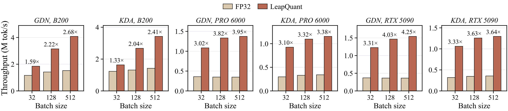

**图 7**：单个线性注意力层的 kernel 吞吐。

【译注：纵轴 Throughput (M tok/s) = 吞吐（百万 token/秒），横轴 Batch size = 批大小。】

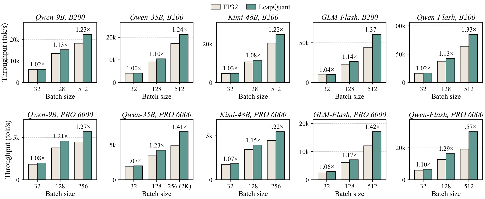

**图 8**：vLLM 中上下文长度为 4K 时的解码步吞吐。在 RTX PRO 6000 上，若批大小 512 放不下，则最大批大小取 256；在该批大小下，Qwen3.5-35B-A3B 使用 2K 而非 4K 的上下文。

**Kernel 加速。** 图 7 把单个线性注意力层（32 个头，$$d_k=d_v=128$$）与 FLA 中的 FP32 kernel 进行比较。在批大小 512 时，LeapQuant 在 B200、RTX PRO 6000 和 RTX 5090 上对 GDN 分别快 2.68×、3.95× 和 4.25×，对 KDA 分别快 2.41×、3.38× 和 3.64×。RTX PRO 6000 和 RTX 5090 上的收益更大，这与循环状态流量在这些 GPU 上是更严重的瓶颈相一致。

**解码加速。** 图 8 在 4K 上下文长度下测量了五个混合模型的纯解码步。在 B200 上、批大小为 512 时，LeapQuant 将解码吞吐提升 1.22–1.37×；在 RTX PRO 6000 上能放下的最大批大小下，提升为 1.22–1.57×。由于线性注意力在每一步中所占的比重随批大小增大而增加，收益也随批大小增大。附录 D 报告了其他上下文长度（最长 128K）下的结果。

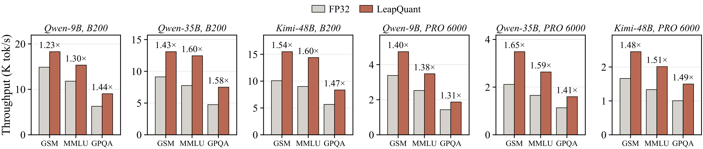

**图 9**：不同数据集上的端到端推理吞吐。

【译注：纵轴 Throughput (K tok/s) = 吞吐（千 token/秒）；GSM = GSM8K，MMLU = MMLU-Pro，GPQA = GPQA-Diamond。】

**显存削减。** LeapQuant 以每元素 1.19 字节（而不是 4 字节）存储每个窗口边界状态，这已经包括 INT8 残差、平滑缩放因子和补偿 token，相当于缩减 3.4×。在窗口长度为 16 时，对 128×128 的状态，FP16 更新缓冲区每层每个头只需约 8 KiB，并且每个活跃请求只分配一次，因此其开销很小。在 vLLM 和 SGLang 的默认模式下启用前缀缓存时，每 1K 个已缓存 token 保存一个检查点。在这一设置下，LeapQuant 在 Qwen3.5-9B、Qwen3.5-35B-A3B 和 Kimi-Linear-48B-A3B 上分别把端到端显存降低 41%、51% 和 56%。这使得在单张 B200 GPU 上服务 Qwen3.5-9B 时，并发请求数最多可提高到 1.4 倍。

**端到端推理加速。** 我们在 GSM8K、MMLU-Pro 和 GPQA 上，按原模型的输入和输出长度运行离线推理。由于 Kimi-Linear 是非推理模型，我们对它采用 Qwen3.5-9B 的长度分布，以模拟生产环境中 KDA 模型的真实负载。凭借更多的并发请求和更快的解码步，LeapQuant 将输出吞吐在 B200 上提升 1.23–1.60×，在 RTX PRO 6000 上提升 1.31–1.65×（图 9）。

### 4.4 消融实验

我们在 Qwen3.5-9B 上对 LeapQuant 的设计选择进行消融，使用表 1 中最敏感的两个任务 AIME 2026 和 LiveCodeBench v6；kernel 加速比均相对于批大小 256 下的 FP32 kernel 计算。

**表 2**：在 Qwen3.5-9B 上对 LeapQuant 各组件的消融。

| 方法 | AIME | LCB | Kernel |
|:---|---:|---:|---:|
| FP32 逐步 | **87.9** | **64.1** | 1.00× |
| BF16 逐步 | 72.1 | 49.6 | 1.64× |
| 　+ 逐窗口 | **87.8** | 62.9 | 1.71× |
| INT8 逐步 | 7.1 | 9.2 | 2.43× |
| 　+ 逐窗口 | 82.4 | 60.6 | 2.64× |
| 　+ 补偿 token | 86.6 | 61.5 | 2.56× |
| 　+ 平滑 | **87.9** | **64.1** | 2.52× |

**各项设计的有效性。** 表 2 在 INT8 状态上逐个加入各项设计，并以 BF16 作为更高精度的参照。逐步 INT8 使 AIME 从 87.9% 降到 7.1%，LiveCodeBench 从 64.1% 降到 9.2%。逐窗口量化把 AIME 和 LiveCodeBench 的精度分别提升到 82.4% 和 60.6%；在 BF16 下，它也把 AIME 从 72.1% 提升到 87.8%。随后，补偿 token 把 INT8 的分数提升到 86.6% 和 61.5%，而平滑在 2.52× kernel 加速下补齐了与 FP32 之间剩余的差距。每个阶段都提升了质量，而完整的 8 比特方法仍保有显著的效率优势。在效率方面，我们与 FP32 和 BF16 的逐步 FLA kernel 以及官方仓库中的 BF16 ReplaySSM kernel（Liou & Dao, 2026）进行比较。集齐三个组件后，LeapQuant 在 2.52× 的 kernel 加速下达到了 FP32 的精度。

**表 3**：在 Qwen3.5-9B 上对窗口长度 $$p$$ 和补偿 token 数量 $$r$$ 的消融。

（左）改变窗口长度 $$p$$（固定 $$r=4$$）：

| $$p$$ | AIME | LCB | Kernel |
|---:|---:|---:|---:|
| 4 | 86.2 | 62.8 | 1.59× |
| 8 | 87.1 | 63.2 | 2.13× |
| 16 | **87.9** | **64.1** | **2.52×** |
| 32 | **87.9** | **64.2** | 2.20× |

（右）改变补偿 token 数量 $$r$$（固定 $$p=16$$）：

| $$r$$ | AIME | LCB | Kernel |
|---:|---:|---:|---:|
| 2 | 85.7 | 63.4 | **2.57×** |
| 4 | 87.9 | **64.1** | 2.52× |
| 8 | **88.1** | **64.0** | 2.37× |
| 16 | 87.9 | 62.8 | 0.74× |

**窗口长度。** 表 3（左）在 $$r=4$$ 下改变窗口大小 $$p$$。窗口越长，量化越不频繁，因此精度一直提升到 $$p=16$$，之后趋于饱和。kernel 在 $$p=16$$ 时最快：更短的窗口需要更频繁地重建状态，而更长的窗口会增大每一步都要读取的记录缓冲区，并让留给流水线的共享内存变少。$$p=32$$ 没有带来进一步的精度提升，却因显存流量增加，使 kernel 加速从 2.52× 降到 2.20×。

**补偿 token 数量。** 表 3（右）在 $$p=16$$ 下改变 $$r$$。精度在 $$r=4$$ 时饱和，这与能量集中在少数几个奇异值上的现象一致（图 5）。在效率方面，在 B200 GPU 上，至多四个补偿 token 的幂迭代与重建工作可以完全与显存读取重叠；但当 $$r$$ 更大时，这部分开销就会暴露出来，在 $$r=16$$ 时甚至让 kernel 比 FP32 还慢。因此我们采用 $$r=4$$：它的精度与更大的 $$r$$ 相当，kernel 速度则接近 $$r=2$$。

---

## 5 结论

我们提出了 LeapQuant，一种无需训练、能对线性注意力的循环状态进行近乎无损量化的方法。LeapQuant 通过每个窗口只量化一次状态来缓解误差累积，并在平滑残差之前，用少量高精度补偿 token 捕获状态中的离群值。在 8 比特状态下，LeapQuant 在长推理和代码生成任务上达到了 FP32 的精度，同时在 GDN 和 KDA 模型上降低了状态显存并加速了解码。随着混合模型把越来越多的层交给线性注意力，我们相信 LeapQuant 能让低精度循环状态成为服务这类模型时切实可行的默认选择。

## 致谢

本研究得到 NSF (IFML) CCF-2019844 的资助，以及 Accenture、AMD、Anyscale、Broadcom Inc.、Google、IBM、Intel、Intesa Sanpaolo、Lambda、Mibura Inc.、Samsung SDS 和 SAP 的捐赠支持。

---

## 参考文献

【译注：参考文献保留原文。】

- Saleh Ashkboos, Amirkeivan Mohtashami, Maximilian L Croci, Bo Li, Pashmina Cameron, Martin Jaggi, Dan Alistarh, Torsten Hoefler, and James Hensman. QuaRot: Outlier-free 4-bit inference in rotated LLMs. *Advances in Neural Information Processing Systems*, 37:100213–100240, 2024.
- Aaron Blakeman, Aarti Basant, Abhinav Khattar, Adithya Renduchintala, Akhiad Bercovich, Aleksander Ficek, Alexis Bjorlin, Ali Taghibakhshi, Amala Sanjay Deshmukh, Ameya Sunil Mahabaleshwarkar, et al. Nemotron-H: A family of accurate and efficient hybrid Mamba-Transformer models. *arXiv preprint arXiv:2504.03624*, 2025.
- Hung-Yueh Chiang, Chi-Chih Chang, Natalia Frumkin, Kai-Chiang Wu, Mohamed S Abdelfattah, and Diana Marculescu. Quamba2: A robust and scalable post-training quantization framework for selective state space models. *arXiv preprint arXiv:2503.22879*, 2025a.
- Hung-Yueh Chiang, Chi-Chih Chang, Natalia Frumkin, Kai-Chiang Wu, and Diana Marculescu. Quamba: A post-training quantization recipe for selective state space models. In *International Conference on Learning Representations*, volume 2025, pp. 101328–101354, 2025b.
- Karl Cobbe, Vineet Kosaraju, Mohammad Bavarian, Mark Chen, Heewoo Jun, Lukasz Kaiser, Matthias Plappert, Jerry Tworek, Jacob Hilton, Reiichiro Nakano, Christopher Hesse, and John Schulman. Training verifiers to solve math word problems. *arXiv preprint arXiv:2110.14168*, 2021.
- Tri Dao and Albert Gu. Transformers are SSMs: Generalized models and efficient algorithms through structured state space duality. *arXiv preprint arXiv:2405.21060*, 2024.
- Elias Frantar, Saleh Ashkboos, Torsten Hoefler, and Dan Alistarh. GPTQ: Accurate post-training quantization for generative pre-trained transformers. *arXiv preprint arXiv:2210.17323*, 2022.
- Coleman Hooper, Sehoon Kim, Hiva Mohammadzadeh, Michael W Mahoney, Yakun S Shao, Kurt Keutzer, and Amir Gholami. KVQuant: Towards 10 million context length LLM inference with KV cache quantization. *Advances in Neural Information Processing Systems*, 37:1270–1303, 2024.
- Naman Jain, Alex Gu, Wen-Ding Li, Fanjia Yan, Tianjun Zhang, Sida Wang, Armando Solar-Lezama, Koushik Sen, and Ion Stoica. LiveCodeBench: Holistic and contamination free evaluation of large language models for code. In *International Conference on Learning Representations*, volume 2025, pp. 58791–58831, 2025.
- Hao Kang, Qingru Zhang, Souvik Kundu, Geonhwa Jeong, Zaoxing Liu, Tushar Krishna, and Tuo Zhao. GEAR: An efficient KV cache compression recipe for near-lossless generative inference of LLM. *arXiv preprint arXiv:2403.05527*, 2024.
- Angelos Katharopoulos, Apoorv Vyas, Nikolaos Pappas, and François Fleuret. Transformers are RNNs: Fast autoregressive transformers with linear attention. In *International Conference on Machine Learning*, pp. 5156–5165. PMLR, 2020.
- Woosuk Kwon, Zhuohan Li, Siyuan Zhuang, Ying Sheng, Lianmin Zheng, Cody Hao Yu, Joseph Gonzalez, Hao Zhang, and Ion Stoica. Efficient memory management for large language model serving with PagedAttention. In *Proceedings of the 29th Symposium on Operating Systems Principles*, pp. 611–626, 2023.
- Muyang Li, Yujun Lin, Zhekai Zhang, Tianle Cai, Xiuyu Li, Junxian Guo, Enze Xie, Chenlin Meng, Jun-Yan Zhu, and Song Han. SVDQuant: Absorbing outliers by low-rank components for 4-bit diffusion models. *arXiv preprint arXiv:2411.05007*, 2024.
- Ji Lin, Jiaming Tang, Haotian Tang, Shang Yang, Wei-Ming Chen, Wei-Chen Wang, Guangxuan Xiao, Xingyu Dang, Chuang Gan, and Song Han. AWQ: Activation-aware weight quantization for on-device LLM compression and acceleration. *Proceedings of Machine Learning and Systems*, 6:87–100, 2024.
- Ze-Wei Liou and Tri Dao. ReplaySSM: Cache SSM inputs, not state. <https://tridao.me/blog/2026/replayssm/>, June 2026.
- Zirui Liu, Jiayi Yuan, Hongye Jin, Shaochen Zhong, Zhaozhuo Xu, Vladimir Braverman, Beidi Chen, and Xia Hu. KIVI: A tuning-free asymmetric 2bit quantization for KV cache. *arXiv preprint arXiv:2402.02750*, 2024.
- Mathematical Association of America. The 44th annual American Invitational Mathematics Examination. Competition Examination, February 2026. URL <https://maa.org/maa-invitational-competitions/>.
- Rui Pan, Zhuang Wang, Zhen Jia, Can Karakus, Luca Zancato, Tri Dao, Yida Wang, and Ravi Netravali. Marconi: Prefix caching for the era of hybrid LLMs. *Proceedings of Machine Learning and Systems*, 7, 2025.
- Bo Peng, Daniel Goldstein, Quentin Anthony, Alon Albalak, Eric Alcaide, Stella Biderman, Eugene Cheah, Xingjian Du, Teddy Ferdinan, Haowen Hou, et al. Eagle and Finch: RWKV with matrix-valued states and dynamic recurrence. *arXiv preprint arXiv:2404.05892*, 2024.
- Bo Peng, Ruichong Zhang, Daniel Goldstein, Eric Alcaide, Xingjian Du, Haowen Hou, Jiaju Lin, Jiaxing Liu, Janna Lu, William Merrill, et al. RWKV-7 "Goose" with expressive dynamic state evolution. *arXiv preprint arXiv:2503.14456*, 2025.
- Zhen Qin, Songlin Yang, Weixuan Sun, Xuyang Shen, Dong Li, Weigao Sun, and Yiran Zhong. HGRN2: Gated linear RNNs with state expansion. *arXiv preprint arXiv:2404.07904*, 2024.
- Qwen Team. Qwen3-Next: Towards ultimate training & inference efficiency. Qwen Blog, September 2025. URL <https://qwen.ai/blog?id=4074cca80393150c248e508aa62983f9cb7d27cd>.
- David Rein, Betty Li Hou, Asa Cooper Stickland, Jackson Petty, Richard Yuanzhe Pang, Julien Dirani, Julian Michael, and Samuel R Bowman. GPQA: A graduate-level Google-proof Q&A benchmark. *arXiv preprint arXiv:2311.12022*, 2023.
- Imanol Schlag, Kazuki Irie, and Jürgen Schmidhuber. Linear transformers are secretly fast weight programmers. In *International Conference on Machine Learning*, pp. 9355–9366. PMLR, 2021.
- Julien Siems, Timur Carstensen, Arber Zela, Frank Hutter, Massimiliano Pontil, and Riccardo Grazzi. DeltaProduct: Improving state-tracking in linear RNNs via Householder products, 2025. URL <https://arxiv.org/abs/2502.10297>.
- Yutao Sun, Li Dong, Shaohan Huang, Shuming Ma, Yuqing Xia, Jilong Xue, Jianyong Wang, and Furu Wei. Retentive network: A successor to transformer for large language models. *arXiv preprint arXiv:2307.08621*, 2023.
- Kimi Team, Yu Zhang, Zongyu Lin, Xingcheng Yao, Jiaxi Hu, Fanqing Meng, Chengyin Liu, Xin Men, Songlin Yang, Zhiyuan Li, et al. Kimi Linear: An expressive, efficient attention architecture. *arXiv preprint arXiv:2510.26692*, 2025.
- Kimi Team, Tongtong Bai, Yifan Bai, Yiping Bao, Jianfeng Cai, Xinyuan Cai, Peizhou Cao, Yuxuan Cao, Ziwei Chai, Y Charles, et al. Kimi K3: Open frontier intelligence. *arXiv preprint arXiv:2607.24653*, 2026.
- Chen Tianqi, Yuanteng Chen, Peisong Wang, Weixiang Xu, Zeyu Zhu, and Jian Cheng. Q-Mamba: Towards more efficient Mamba models via post-training quantization. In *Findings of the Association for Computational Linguistics: ACL 2025*, pp. 10594–10610, 2025.
- Philippe Tillet, H. T. Kung, and David Cox. Triton: an intermediate language and compiler for tiled neural network computations. In *Proceedings of the 3rd ACM SIGPLAN International Workshop on Machine Learning and Programming Languages (MAPL 2019)*, pp. 10–19, New York, NY, USA, 2019. Association for Computing Machinery. doi: 10.1145/3315508.3329973.
- Ashish Vaswani, Noam Shazeer, Niki Parmar, Jakob Uszkoreit, Llion Jones, Aidan N Gomez, Łukasz Kaiser, and Illia Polosukhin. Attention is all you need. *Advances in Neural Information Processing Systems*, 30, 2017.
- Lei Wang, Yu Cheng, Yining Shi, Zhengju Tang, Zhiwen Mo, Wenhao Xie, Lingxiao Ma, Yuqing Xia, Jilong Xue, Fan Yang, et al. TileLang: A composable tiled programming model for AI systems. *arXiv preprint arXiv:2504.17577*, 2025.
- Yubo Wang, Xueguang Ma, Ge Zhang, Yuansheng Ni, Abhranil Chandra, Shiguang Guo, Weiming Ren, Aaran Arulraj, Xuan He, Ziyan Jiang, et al. MMLU-Pro: A more robust and challenging multi-task language understanding benchmark. *Advances in Neural Information Processing Systems*, 37:95266–95290, 2024.
- Samuel Williams, Andrew Waterman, and David Patterson. Roofline: an insightful visual performance model for multicore architectures. *Communications of the ACM*, 52(4):65–76, 2009.
- Guangxuan Xiao, Ji Lin, Mickael Seznec, Hao Wu, Julien Demouth, and Song Han. SmoothQuant: Accurate and efficient post-training quantization for large language models. In *International Conference on Machine Learning*, pp. 38087–38099. PMLR, 2023.
- Songlin Yang and Yu Zhang. FLA: A Triton-based library for hardware-efficient implementations of linear attention mechanism, January 2024. URL <https://github.com/fla-org/flash-linear-attention>.
- Songlin Yang, Bailin Wang, Yikang Shen, Rameswar Panda, and Yoon Kim. Gated linear attention transformers with hardware-efficient training. *arXiv preprint arXiv:2312.06635*, 2023.
- Songlin Yang, Bailin Wang, Yu Zhang, Yikang Shen, and Yoon Kim. Parallelizing linear transformers with the delta rule over sequence length. *Advances in Neural Information Processing Systems*, 37:115491–115522, 2024.
- Songlin Yang, Jan Kautz, and Ali Hatamizadeh. Gated delta networks: Improving Mamba2 with delta rule. In *International Conference on Learning Representations*, volume 2025, pp. 29687–29707, 2025.
- Yuxuan Yue, Xing Hu, Dawei Yang, Zhihang Yuan, Zixu Jiang, Zhixuan Chen, Jiangyong Yu, and Sifan Zhou. MambaQuant: Quantizing the Mamba family with variance aligned rotation methods. In *International Conference on Learning Representations*, volume 2025, pp. 33231–33250, 2025.
- Z.ai. GLM-5.3-Flash: Frontier intelligence, flash cost. Z.ai Blog, August 2026. URL <https://z.ai/blog/glm-5.3-flash>.
- Amir Zandieh, Majid Daliri, Majid Hadian, and Vahab Mirrokni. TurboQuant: Online vector quantization with near-optimal distortion rate. In *International Conference on Learning Representations*, volume 2026, pp. 56418–56439, 2026.

---

# 附录

## A 通用更新形式的实例

在下面针对各个模型的展开和递推推导中，$$D_t=\mathrm{Diag}(d_t)$$、$$\tilde k_t$$ 和 $$b_t$$ 分别对应正文中的 $$\mathrm{Diag}(\alpha_t)$$、$$k_t$$ 和 $$\beta_t$$，且 $$d_t=\alpha_t$$。这套记号把通用递推中的系数，与各模型原生更新中的原始键和标量门控区分开来。于是，3.1 节把我们所考虑的每个模型都写成如下形式：

$$
S_t = D_t S_{t-1} + \tilde k_t\bigl(v_t - S_{t-1}^{\top} b_t\bigr)^{\top}, \qquad o_t = S_t^{\top} q_t,
$$

其中 $$D_t=\mathrm{Diag}(d_t)$$ 为对角衰减，$$\tilde k_t$$ 为写入键（write key），$$b_t$$ 为读取向量。表 4 列出了常见的实例：线性注意力（Katharopoulos et al., 2020）、RetNet（Sun et al., 2023）、Mamba2（Dao & Gu, 2024）、GLA（Yang et al., 2023）、RWKV6（Peng et al., 2024）、HGRN2（Qin et al., 2024）、DeltaNet（Yang et al., 2024）、Gated DeltaNet（Yang et al., 2025）、KDA（Team et al., 2025）以及 DeltaProduct（Siems et al., 2025）。衰减可以是单位矩阵、常数标量、数据相关的标量，也可以是数据相关的向量。项 $$S_{t-1}^{\top}b_t$$ 读取上一个状态，写入操作则沿同一方向 $$\tilde k_t$$ 把它从 $$v_t$$ 中减去——这就是 delta 规则。普通线性注意力和门控线性注意力的 $$b_t=0$$。

**表 4**：式 (1) 的实例。DeltaProduct 对每个 token 施加 $$n$$ 个 delta 规则子步，每个子步都是式 (1) 的一个实例。最后一列给出一条缓冲更新 $$(d_i,\tilde k_i,u_i)$$ 中所含数值的个数。

| 模型 | $$D_t$$ | $$\tilde k_t$$ | $$b_t$$ | 记录大小 |
|:---|:---:|:---:|:---:|:---:|
| Linear Attention | $$I$$ | $$k_t$$ | $$0$$ | $$d_k+d_v$$ |
| RetNet | $$\gamma I$$ | $$k_t$$ | $$0$$ | $$d_k+d_v$$ |
| Mamba2 | $$\alpha_t I$$ | $$k_t$$ | $$0$$ | $$1+d_k+d_v$$ |
| GLA / RWKV6 / HGRN2 | $$\mathrm{Diag}(\alpha_t)$$ | $$k_t$$ | $$0$$ | $$2d_k+d_v$$ |
| DeltaNet | $$I$$ | $$\beta_t k_t$$ | $$k_t$$ | $$d_k+d_v$$ |
| Gated DeltaNet | $$\alpha_t I$$ | $$\beta_t k_t$$ | $$\alpha_t k_t$$ | $$1+d_k+d_v$$ |
| KDA | $$\mathrm{Diag}(\alpha_t)$$ | $$\beta_t k_t$$ | $$\alpha_t\odot k_t$$ | $$2d_k+d_v$$ |
| DeltaProduct，子步 $$j$$ | $$I$$ | $$\beta_{t,j}k_{t,j}$$ | $$k_{t,j}$$ | $$d_k+d_v$$ |

**Gated DeltaNet 与 KDA。** 展开原始的更新公式即可得到表 4 中对应的行：

$$
\begin{aligned}
\text{GDN:}\quad \alpha_t\bigl(I-\beta_tk_tk_t^{\top}\bigr)S_{t-1}+\beta_tk_tv_t^{\top} &= \alpha_tS_{t-1} + \beta_tk_t\bigl(v_t - S_{t-1}^{\top}(\alpha_tk_t)\bigr)^{\top},\\
\text{KDA:}\quad \bigl(I-\beta_tk_tk_t^{\top}\bigr)\mathrm{Diag}(\alpha_t)S_{t-1}+\beta_tk_tv_t^{\top} &= \mathrm{Diag}(\alpha_t)S_{t-1} + \beta_tk_t\bigl(v_t - S_{t-1}^{\top}(\alpha_t\odot k_t)\bigr)^{\top}.
\end{aligned}
$$

在这两种情况下，擦除方向都与写入键一致，因此每个 token 只贡献一条秩一记录。在这一约定中，步长 $$\beta_t$$ 由写入键承载；若改为放在修正量中，即 $$\tilde k_t=k_t$$、$$u_t=\beta_t(v_t-S_{t-1}^{\top}b_t)$$，两者是等价的。

**擦除方向与写入键不同的模型。** 式 (1) 要求擦除方向与写入键一致。擦除方向与写入键不同的模型，仍然可以通过把每个 token 拆成式 (1) 的两个子步来纳入这一形式。以 RWKV7（Peng et al., 2025）为例，其状态转移为 $$\mathrm{Diag}(w_t)-\hat{\kappa}_t(a_t\odot\hat{\kappa}_t)^{\top}$$，两个子步分别是一个 $$v=0$$ 的擦除步，和一个 $$D=I$$、$$b=0$$ 的纯写入步：

$$
\begin{aligned}
S_t' &= \mathrm{Diag}(w_t)\,S_{t-1} + \hat{\kappa}_t\bigl(0 - S_{t-1}^{\top}(a_t\odot\hat{\kappa}_t)\bigr)^{\top},\\
S_t &= S_t' + k_t v_t^{\top}.
\end{aligned}
$$

这样每个 token 贡献两条秩一记录，处理方式与 $$n=2$$ 的 DeltaProduct token 相同。

## B 推导

### B.1 量化引起的偏差的传播

为进行这一递推层面的分析，我们固定层输入序列，并为 FP32 参考递推和量化递推提供相同的系数 $$(d_t,\tilde k_t,b_t,v_t)$$：

$$
\begin{aligned}
S_t^{\mathrm{FP32}} &= D_tS_{t-1}^{\mathrm{FP32}} + \tilde k_t\bigl(v_t - (S_{t-1}^{\mathrm{FP32}})^{\top}b_t\bigr)^{\top},\\
S_t &= D_t\hat S_{t-1} + \tilde k_t\bigl(v_t - \hat S_{t-1}^{\top}b_t\bigr)^{\top}.
\end{aligned}
$$

两式相减，值 $$v_t$$ 被消去：

$$
S_t - S_t^{\mathrm{FP32}} = D_tE_{t-1} - \tilde k_t\bigl(E_{t-1}^{\top}b_t\bigr)^{\top}.
$$

两边同时加上 $$\varepsilon_t=\mathtt{dequant}_b(\hat S_t)-S_t$$，得到

$$
E_t=D_tE_{t-1}-\tilde k_t\bigl(E_{t-1}^{\top}b_t\bigr)^{\top}+\varepsilon_t. \tag{8}
$$

把它展开可以看到，每个误差 $$\varepsilon_s$$ 都会经由那些作用于第 $$s$$ 步所写入记忆的衰减和擦除步骤，被带到第 $$t$$ 步，并通过 $$o_t=S_t^{\top}q_t$$ 影响输出。在逐窗口量化下，$$\varepsilon_s$$ 只在窗口边界处非零。由于每次更新相对于状态都很小，逐步舍入在每一步都会丢掉其中的一部分，因此这些误差是相关的，会相干地叠加起来。逐窗口量化只对累积后的更新做一次舍入，所以它对误差的降低幅度远大于量化频率降低的倍数 $$p$$。

### B.2 窗口展开与状态读出

恢复任意的窗口起始下标 $$t$$ 后，式 (4) 可以由式 (3) 对窗口长度做归纳得到：多施加一条记录，相当于把已有的每一项都乘以 $$D_{t+p+1}$$ 并追加一项 $$\tilde k_{t+p+1}u_{t+p+1}^{\top}$$，而 $$D_{t+p+1}\Gamma_{a:t+p}=\Gamma_{a:t+p+1}$$。对第 $$i$$ 步展开后的状态取转置并乘以 $$x$$，对 $$t\le i\le t+p$$ 有

$$
S_i^{\top}x=\hat S_t^{\top}\Gamma_{t+1:i}x +\sum_{j=t+1}^{i}u_j\bigl(\tilde k_j^{\top}\Gamma_{j+1:i}x\bigr), \tag{9}
$$

这里利用了对角矩阵 $$\Gamma$$ 满足 $$\Gamma^{\top}=\Gamma$$。第一项的开销为 $$O(d_kd_v)$$，而 $$i-t$$ 条记录中每一条的开销为 $$O(d_k+d_v)$$：一次内积 $$\tilde k_j^{\top}(\Gamma_{j+1:i}x)$$ 加上一个缩放后的向量 $$u_j$$。对角乘积 $$\Gamma_{j+1:i}$$ 是累积衰减，可以增量维护，因此读出过程中从不需要构造 $$d_k\times d_v$$ 的中间状态。

### B.3 带平滑量化残差的读出

对于逐值通道（per-value-channel）的对称 INT8 量化，令 $$Z_0$$ 表示整数载荷，$$B$$ 表示对角缩放矩阵，则 $$\mathtt{dequant}_b(\hat R_0^C)=(Z_0/127)B$$。因此，对任意读取向量 $$x$$ 和累积对角衰减 $$\Gamma$$，

$$
\bigl[C\,\mathtt{dequant}_b(\hat R_0^C)\bigr]^{\top}\Gamma x =\left(C\frac{Z_0}{127}B\right)^{\top}\Gamma x =B\frac{Z_0^{\top}}{127}C\Gamma x.
$$

其中 $$C$$ 和 $$\Gamma$$ 作用在键坐标上，而 $$B$$ 对量化残差在值一侧的投影进行缩放。这两种缩放都不作用于真实 token 或补偿 token 的记录，因为它们的贡献本来就是在原始状态坐标下表示的。

对于补偿 token 分量 $$\tilde K\tilde U^{\top}$$，相应的读出为

$$
(\tilde K\tilde U^{\top})^{\top}\Gamma x =\tilde U(\tilde K^{\top}\Gamma x) =\sum_{h=1}^{r}\tilde u_h(\tilde k_h^{\top}\Gamma x).
$$

把这些秩一记录和真实记录的读出加到量化残差的读出上，就得到式 (7) 对应的读出形式：

$$
\begin{aligned}
S_\ell^{\top}x ={}&\mathtt{dequant}_b(\hat R_0^C)^{\top}C\Gamma_{1:\ell}x +\tilde U\bigl(\tilde K^{\top}\Gamma_{1:\ell}x\bigr)\\
&+\sum_{j=1}^{\ell}u_j\bigl(k_j^{\top}\Gamma_{j+1:\ell}x\bigr).
\end{aligned}
\tag{10}
$$

在边界处，先在原始状态坐标下重建这一总和，再拟合新的因子并重新计算残差的缩放因子。

## C 完整下游结果

表 5 在表 1 的基础上加入了 GSM8K，并列出了我们在 8、6、4 比特下评估过的所有直接量化格式和改造方法。每组中直接量化格式列在改造方法之前，并且所有基线都在每个解码步重新量化状态。LeapQuant 在每个比特宽度下都使用 4.1 节中的配置。

**表 5**：完整下游性能（%，越高越好）。每个比特宽度内，各列最佳分数以粗体标出。

<table>
<thead>
<tr><th rowspan="2" align="left">方法</th>
<th colspan="5">Qwen3.5-9B</th>
<th colspan="5">Qwen3.5-35B-A3B</th>
<th colspan="5">Kimi-Linear-48B-A3B</th>
</tr>
<tr><th>GSM</th><th>AIME</th><th>GPQA</th><th>LCB</th><th>MMLU</th><th>GSM</th><th>AIME</th><th>GPQA</th><th>LCB</th><th>MMLU</th><th>GSM</th><th>AIME</th><th>GPQA</th><th>LCB</th><th>MMLU</th></tr>
</thead>
<tbody>
<tr><td align="left">FP32</td><td align="right">96.1</td><td align="right">87.9</td><td align="right">81.3</td><td align="right">64.1</td><td align="right">83.3</td><td align="right">96.7</td><td align="right">91.5</td><td align="right">84.7</td><td align="right">75.6</td><td align="right">85.9</td><td align="right">92.1</td><td align="right">67.5</td><td align="right">70.3</td><td align="right">41.4</td><td align="right">72.4</td></tr>
<tr><td align="left">BF16</td><td align="right">94.9</td><td align="right">72.1</td><td align="right">66.2</td><td align="right">49.6</td><td align="right">81.0</td><td align="right">96.6</td><td align="right">85.8</td><td align="right">79.3</td><td align="right">67.2</td><td align="right">85.2</td><td align="right">92.1</td><td align="right">64.3</td><td align="right">68.1</td><td align="right">41.0</td><td align="right">64.0</td></tr>
<tr><td colspan="16" align="left"><i>8 比特方法</i></td></tr>
<tr style="background:#E4EEFB"><td align="left"><b>LeapQuant（本文）</b></td><td align="right"><b>96.3</b></td><td align="right"><b>87.9</b></td><td align="right"><b>81.8</b></td><td align="right"><b>64.1</b></td><td align="right"><b>83.8</b></td><td align="right"><b>96.5</b></td><td align="right"><b>91.0</b></td><td align="right"><b>83.9</b></td><td align="right"><b>76.1</b></td><td align="right"><b>85.8</b></td><td align="right">92.0</td><td align="right"><b>68.3</b></td><td align="right"><b>69.8</b></td><td align="right">41.3</td><td align="right">72.1</td></tr>
<tr><td align="left">FP8 逐张量</td><td align="right">79.2</td><td align="right">14.6</td><td align="right">34.3</td><td align="right">21.4</td><td align="right">42.6</td><td align="right">86.7</td><td align="right">29.6</td><td align="right">39.9</td><td align="right">26.7</td><td align="right">56.4</td><td align="right">91.8</td><td align="right">25.6</td><td align="right">46.6</td><td align="right">16.0</td><td align="right">57.0</td></tr>
<tr><td align="left">FP8 逐通道</td><td align="right">84.2</td><td align="right">0.8</td><td align="right">13.6</td><td align="right">11.5</td><td align="right">46.6</td><td align="right">76.9</td><td align="right">0.0</td><td align="right">5.6</td><td align="right">8.4</td><td align="right">36.6</td><td align="right">91.6</td><td align="right">35.4</td><td align="right">57.6</td><td align="right">16.5</td><td align="right">65.5</td></tr>
<tr><td align="left">FP8 逐组</td><td align="right">71.2</td><td align="right">0.0</td><td align="right">2.5</td><td align="right">2.3</td><td align="right">25.8</td><td align="right">67.2</td><td align="right">0.0</td><td align="right">1.5</td><td align="right">2.3</td><td align="right">24.9</td><td align="right">91.7</td><td align="right">25.3</td><td align="right">47.6</td><td align="right">15.8</td><td align="right">63.5</td></tr>
<tr><td align="left">MXFP8</td><td align="right">67.9</td><td align="right">7.1</td><td align="right">24.2</td><td align="right">15.3</td><td align="right">32.2</td><td align="right">80.6</td><td align="right">29.6</td><td align="right">36.4</td><td align="right">29.8</td><td align="right">45.5</td><td align="right">91.4</td><td align="right">43.5</td><td align="right">50.3</td><td align="right">23.4</td><td align="right">67.0</td></tr>
<tr><td align="left">INT8 逐张量</td><td align="right">38.5</td><td align="right">0.0</td><td align="right">3.0</td><td align="right">3.1</td><td align="right">25.1</td><td align="right">10.2</td><td align="right">0.0</td><td align="right">3.5</td><td align="right">1.5</td><td align="right">8.5</td><td align="right">89.9</td><td align="right">5.3</td><td align="right">31.3</td><td align="right">8.4</td><td align="right">54.8</td></tr>
<tr><td align="left">INT8 逐通道</td><td align="right">53.5</td><td align="right">7.1</td><td align="right">26.8</td><td align="right">9.2</td><td align="right">44.3</td><td align="right">16.5</td><td align="right">0.0</td><td align="right">0.0</td><td align="right">3.1</td><td align="right">6.8</td><td align="right">91.8</td><td align="right">52.8</td><td align="right">65.8</td><td align="right">35.5</td><td align="right">64.5</td></tr>
<tr><td align="left">KVQuant</td><td align="right">95.1</td><td align="right">74.6</td><td align="right">70.2</td><td align="right">59.5</td><td align="right">82.4</td><td align="right">95.8</td><td align="right">76.3</td><td align="right">69.7</td><td align="right">44.3</td><td align="right">83.5</td><td align="right">92.0</td><td align="right">66.6</td><td align="right">69.7</td><td align="right"><b>42.1</b></td><td align="right">65.0</td></tr>
<tr><td align="left">QuaRot</td><td align="right">93.1</td><td align="right">49.6</td><td align="right">57.1</td><td align="right">38.2</td><td align="right">73.1</td><td align="right">80.7</td><td align="right">32.9</td><td align="right">36.4</td><td align="right">15.3</td><td align="right">56.0</td><td align="right"><b>92.6</b></td><td align="right">63.3</td><td align="right">69.2</td><td align="right">36.6</td><td align="right"><b>73.1</b></td></tr>
<tr><td align="left">TurboQuant</td><td align="right">94.8</td><td align="right">70.8</td><td align="right">61.1</td><td align="right">45.0</td><td align="right">80.5</td><td align="right">82.9</td><td align="right">10.4</td><td align="right">22.7</td><td align="right">15.3</td><td align="right">52.7</td><td align="right">92.3</td><td align="right">57.5</td><td align="right">69.2</td><td align="right">41.2</td><td align="right">69.0</td></tr>
<tr><td colspan="16" align="left"><i>6 比特方法</i></td></tr>
<tr style="background:#E4EEFB"><td align="left"><b>LeapQuant（本文）</b></td><td align="right"><b>95.5</b></td><td align="right"><b>85.8</b></td><td align="right"><b>79.8</b></td><td align="right"><b>59.5</b></td><td align="right"><b>81.7</b></td><td align="right"><b>95.2</b></td><td align="right"><b>88.8</b></td><td align="right"><b>83.8</b></td><td align="right"><b>68.7</b></td><td align="right"><b>79.5</b></td><td align="right">91.8</td><td align="right"><b>66.1</b></td><td align="right"><b>66.2</b></td><td align="right"><b>35.9</b></td><td align="right"><b>73.4</b></td></tr>
<tr><td align="left">NVFP6</td><td align="right">66.7</td><td align="right">0.4</td><td align="right">18.7</td><td align="right">12.2</td><td align="right">28.3</td><td align="right">75.4</td><td align="right">13.8</td><td align="right">34.3</td><td align="right">25.2</td><td align="right">46.3</td><td align="right">92.5</td><td align="right">30.8</td><td align="right">52.0</td><td align="right">25.2</td><td align="right">67.4</td></tr>
<tr><td align="left">MXFP6</td><td align="right">15.9</td><td align="right">0.0</td><td align="right">1.0</td><td align="right">3.1</td><td align="right">8.7</td><td align="right">37.1</td><td align="right">0.0</td><td align="right">7.1</td><td align="right">9.2</td><td align="right">23.6</td><td align="right">91.8</td><td align="right">37.1</td><td align="right">53.5</td><td align="right">19.1</td><td align="right">66.7</td></tr>
<tr><td align="left">INT6 逐通道</td><td align="right">50.6</td><td align="right">0.0</td><td align="right">5.6</td><td align="right">1.5</td><td align="right">23.5</td><td align="right">1.0</td><td align="right">0.0</td><td align="right">3.0</td><td align="right">0.0</td><td align="right">3.9</td><td align="right">91.3</td><td align="right">22.9</td><td align="right">50.0</td><td align="right">13.7</td><td align="right">64.2</td></tr>
<tr><td align="left">KVQuant</td><td align="right">79.3</td><td align="right">4.2</td><td align="right">23.2</td><td align="right">13.7</td><td align="right">40.5</td><td align="right">59.8</td><td align="right">0.0</td><td align="right">10.1</td><td align="right">2.3</td><td align="right">21.6</td><td align="right">91.9</td><td align="right">55.0</td><td align="right"><b>66.2</b></td><td align="right">29.8</td><td align="right">71.8</td></tr>
<tr><td align="left">QuaRot</td><td align="right">51.9</td><td align="right">0.0</td><td align="right">10.1</td><td align="right">3.1</td><td align="right">26.6</td><td align="right">8.8</td><td align="right">0.0</td><td align="right">0.5</td><td align="right">0.0</td><td align="right">2.9</td><td align="right">92.5</td><td align="right">25.4</td><td align="right">43.9</td><td align="right">17.6</td><td align="right">64.2</td></tr>
<tr><td align="left">TurboQuant</td><td align="right">87.5</td><td align="right">27.5</td><td align="right">29.8</td><td align="right">16.0</td><td align="right">61.2</td><td align="right">54.1</td><td align="right">0.4</td><td align="right">5.1</td><td align="right">4.6</td><td align="right">16.1</td><td align="right"><b>92.7</b></td><td align="right">48.8</td><td align="right">64.7</td><td align="right"><b>35.9</b></td><td align="right">72.7</td></tr>
<tr><td colspan="16" align="left"><i>4 比特方法</i></td></tr>
<tr style="background:#E4EEFB"><td align="left"><b>LeapQuant（本文）</b></td><td align="right"><b>95.9</b></td><td align="right"><b>58.1</b></td><td align="right"><b>65.7</b></td><td align="right"><b>34.0</b></td><td align="right"><b>80.2</b></td><td align="right"><b>96.0</b></td><td align="right"><b>59.2</b></td><td align="right"><b>57.6</b></td><td align="right"><b>37.4</b></td><td align="right"><b>81.4</b></td><td align="right"><b>92.0</b></td><td align="right"><b>67.9</b></td><td align="right"><b>69.2</b></td><td align="right"><b>40.5</b></td><td align="right"><b>73.4</b></td></tr>
<tr><td align="left">NVFP4</td><td align="right">0.4</td><td align="right">0.0</td><td align="right">0.0</td><td align="right">0.0</td><td align="right">2.0</td><td align="right">0.4</td><td align="right">0.0</td><td align="right">0.0</td><td align="right">0.0</td><td align="right">0.3</td><td align="right">85.1</td><td align="right">0.0</td><td align="right">6.4</td><td align="right">0.8</td><td align="right">9.7</td></tr>
<tr><td align="left">MXFP4</td><td align="right">4.6</td><td align="right">0.0</td><td align="right">5.1</td><td align="right">0.0</td><td align="right">7.4</td><td align="right">3.9</td><td align="right">0.0</td><td align="right">4.5</td><td align="right">0.8</td><td align="right">5.5</td><td align="right">87.7</td><td align="right">4.2</td><td align="right">26.9</td><td align="right">8.7</td><td align="right">53.1</td></tr>
<tr><td align="left">INT4 逐通道</td><td align="right">0.2</td><td align="right">0.0</td><td align="right">6.6</td><td align="right">0.0</td><td align="right">5.8</td><td align="right">0.2</td><td align="right">0.0</td><td align="right">0.0</td><td align="right">0.0</td><td align="right">0.7</td><td align="right">78.1</td><td align="right">0.0</td><td align="right">7.1</td><td align="right">0.8</td><td align="right">28.8</td></tr>
<tr><td align="left">KVQuant</td><td align="right">1.1</td><td align="right">0.0</td><td align="right">0.0</td><td align="right">0.0</td><td align="right">1.0</td><td align="right">0.0</td><td align="right">0.0</td><td align="right">0.0</td><td align="right">0.0</td><td align="right">0.0</td><td align="right">89.6</td><td align="right">4.2</td><td align="right">19.7</td><td align="right">2.3</td><td align="right">46.9</td></tr>
<tr><td align="left">QuaRot</td><td align="right">0.6</td><td align="right">0.0</td><td align="right">0.5</td><td align="right">0.0</td><td align="right">1.6</td><td align="right">0.0</td><td align="right">0.0</td><td align="right">0.0</td><td align="right">0.0</td><td align="right">0.0</td><td align="right">84.3</td><td align="right">0.8</td><td align="right">15.2</td><td align="right">1.5</td><td align="right">38.2</td></tr>
<tr><td align="left">TurboQuant</td><td align="right">41.6</td><td align="right">3.3</td><td align="right">26.8</td><td align="right">13.0</td><td align="right">47.4</td><td align="right">0.0</td><td align="right">0.0</td><td align="right">0.0</td><td align="right">0.0</td><td align="right">0.3</td><td align="right">90.3</td><td align="right">24.2</td><td align="right">63.1</td><td align="right">26.7</td><td align="right">69.5</td></tr>
</tbody>
</table>

【译注：GSM = GSM8K；其余缩写同表 1。】

## D 补充效率评估

图 10 报告了 B200 上上下文长度从 1K 到 8K 的解码步吞吐，作为对图 8 中 4K 结果的补充。每根柱子把 FP32 的吞吐（浅色）和 LeapQuant 带来的增益（深色）叠在一起。对于把线性注意力与稠密全注意力组合的模型，随着上下文增长，全注意力层在每一步中所占的份额越来越大，因此增益略有缩小。但在 8K 时增益依然可观：批大小 512 时，LeapQuant 仍能把 Kimi-Linear-48B-A3B 加速 1.18×。近期的模型越来越多地把线性注意力与稀疏注意力（而非全注意力）组合，这使得注意力开销随上下文增长几乎保持不变。图 11 在批大小 256 下评估了两个这样的模型——GLM-5.3-Flash 和 Qwen3.8-Flash，上下文分别最长到 128K 和 96K。LeapQuant 在 4K 时分别把它们加速 1.25× 和 1.23×，在最长上下文处仍分别加速 1.23× 和 1.20×。因此我们预计，在未来的混合模型上，LeapQuant 在超长上下文下同样会表现良好。

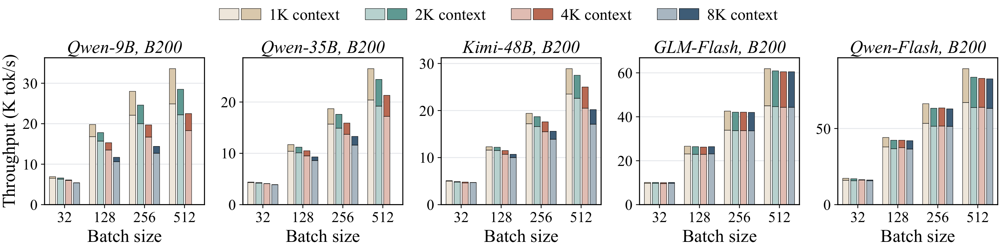

**图 10**：B200 上 vLLM 在 1K–8K 上下文长度下的解码步吞吐。每根柱子把 FP32 的吞吐（浅色）和 LeapQuant 的增益（深色）叠在一起。

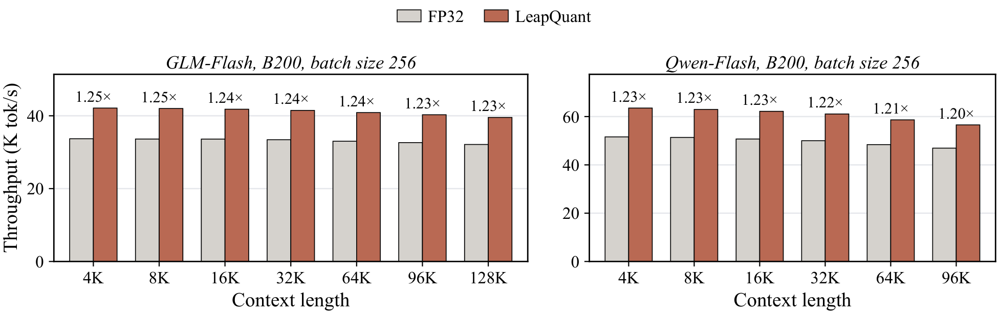

**图 11**：两个稀疏注意力模型在 B200、批大小 256、长上下文下的解码步吞吐。

## E 评估细节

**采样参数。** 表 6 列出了生成设置。同一模型的所有方法共享相同的设置、提示词和样本集。对于 Qwen3.5 系列模型，我们遵循其官方模型卡中开启思考模式的基准测试设置；Kimi-Linear-48B-A3B-Instruct 是没有思考模式的指令模型。最大模型长度设为输出上限加 8,192 个 token，以保证没有任何生成会在达到输出上限之前被上下文窗口截断。

**表 6**：下游评估的生成设置。

| 模型 | 温度 | Top-$$p$$ | Top-$$k$$ | Presence 惩罚 | 思考模式 | 最大输出长度 |
|:---|:---:|:---:|:---:|:---:|:---:|---:|
| Qwen3.5-9B | 1.0 | 0.95 | 20 | 1.5 | 开 | 81,920 |
| Qwen3.5-35B-A3B | 1.0 | 0.95 | 20 | 1.5 | 开 | 81,920 |
| Kimi-Linear-48B-A3B | 1.0 | 1.0 | – | 0 | – | 65,536 |

---

## 附：LaTeX 源码中被注释掉的两段声明

【译注：以下两段存在于作者上传的 LaTeX 源码（`contents/ai_usage.tex` 与 `contents/reproducibility.tex`）中，但在 `main.tex` 里被注释掉，因此没有出现在 arXiv 发布的 PDF 中。为完整起见一并译出，仅供参考。】

**AI 使用声明。** 在完成论文初稿之后，由于作者并非英语母语者，我们使用大语言模型来润色文字，主要用于纠正语法和改进措辞。我们还使用了编程智能体（coding agents）来帮助实现本文的方法并运行实验。整个过程都在严密的人工监督下进行：方法和实验由作者设计，所有代码、结果和修改都经过作者审阅。

**可复现性声明。** LeapQuant 既不需要训练，也不需要校准数据，本文中的所有模型和基准都是公开可用的。第 3 节和附录 B 给出了逐窗口量化、补偿 token 和残差平滑的完整公式及推导，附录 A 说明了其他线性注意力模型如何纳入同一更新形式。4.1 节说明了模型、基准、LeapQuant 的配置（窗口长度、补偿 token 数量和残差格式）以及硬件，附录 E 列出了每个模型的采样参数和评估集。附录 C 报告了我们评估过的每一种基线格式的结果。我们将在论文正式发表时开源 vLLM 实现和 TileLang kernel。
